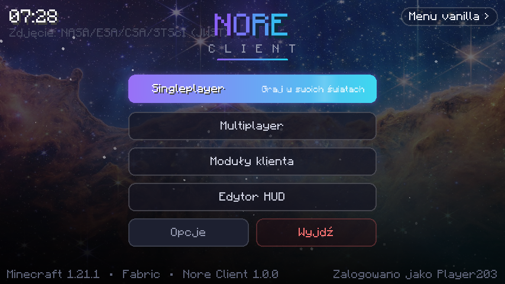
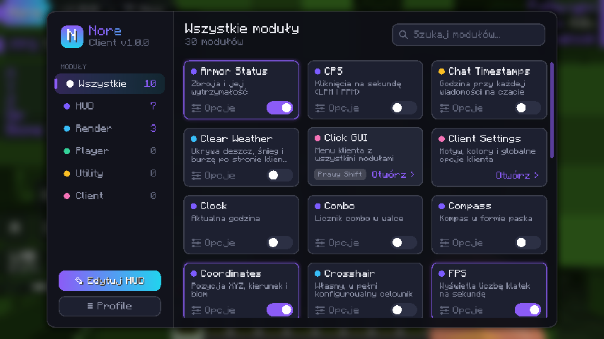
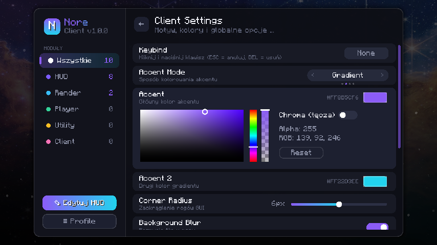
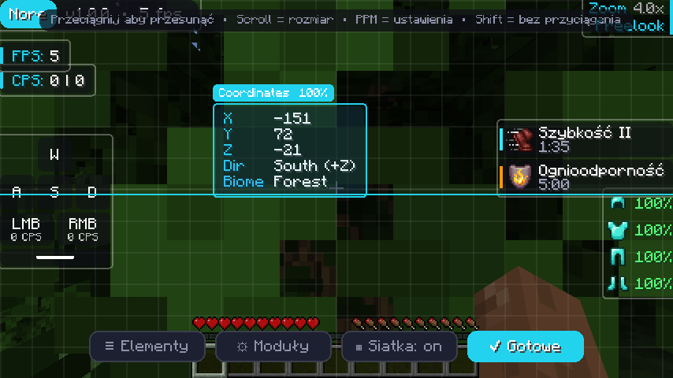
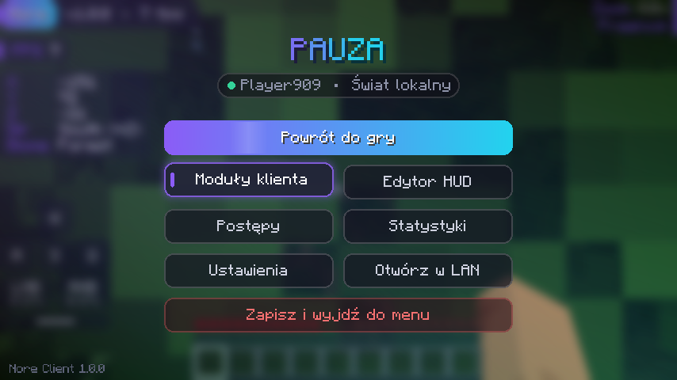
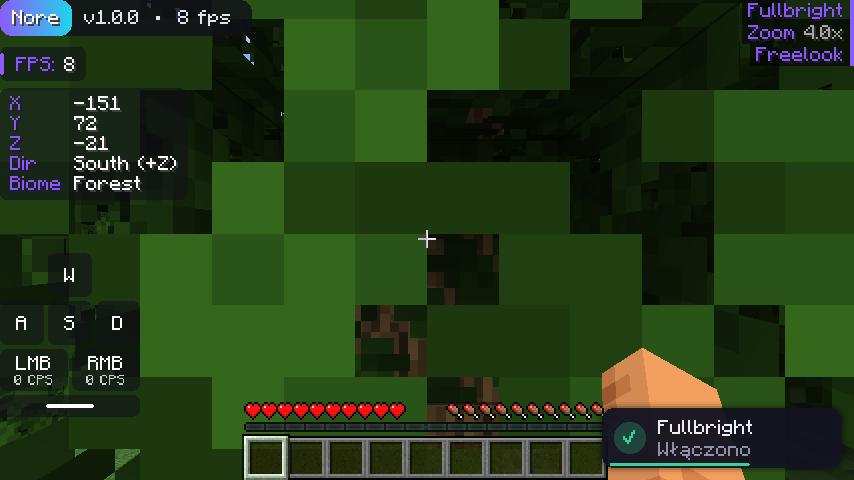
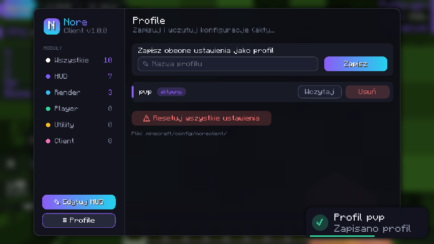

# Nore Client

Rozbudowany klient do **Minecraft 1.21.1** (Fabric), z dopracowanym, animowanym interfejsem:
własne menu główne i menu pauzy, menu modułów (ClickGUI), edytor HUD, nakładki,
profile konfiguracji i wiele modułów PvP/QoL.



| Menu modułów | Ustawienia + color picker |
|---|---|
|  |  |
| **Edytor HUD** (przeciąganie, przyciąganie do linii) | **Menu pauzy** |
|  |  |
| **HUD + powiadomienia** | **Profile** |
|  |  |

## Instalacja

1. Zainstaluj [Fabric Loader](https://fabricmc.net/use/) dla 1.21.1 oraz [Fabric API](https://modrinth.com/mod/fabric-api).
2. Zbuduj moda: `./gradlew build` (wymaga Javy 21) – plik pojawi się w `build/libs/noreclient-1.0.0.jar`.
3. Wrzuć jar do folderu `.minecraft/mods`.

Uruchomienie testowe ze środowiska deweloperskiego: `./gradlew runClient`.

## Sterowanie

| Klawisz | Akcja |
|---|---|
| `Prawy Shift` | Menu modułów (ClickGUI) |
| `H` | Edytor HUD |
| `C` (przytrzymaj) | Zoom – kółkiem myszy zmieniasz przybliżenie |
| `Lewy Alt` (przytrzymaj) | Freelook – rozglądanie się wokół postaci |
| `B` | Fullbright |

Każdemu modułowi można przypisać własny klawisz (karta modułu → *Opcje* → *Keybind*).
Klawisze Zoom / Freelook / Edytor HUD zmienisz w *Opcje → Sterowanie → Nore Client*.

## Interfejs

- **Menu główne** – animowane tło (zdjęcie JWST z powolnym zoomem i paralaksą od myszy, migoczące gwiazdy),
  kaskadowe wejście elementów, przyciski z poświatą, unoszeniem i podpowiedziami, płynne przejścia między ekranami.
- **Menu modułów** – animacja otwierania/zamykania (skala + zanikanie), przesuwany wskaźnik kategorii,
  kaskadowe pojawianie się kart, wyszukiwarka (zacznij pisać w dowolnym miejscu), przełączniki, suwaki,
  wybór trybów z animacją przesuwania, rozwijany color picker (HSB, przezroczystość, tryb tęczy/chroma), przypisywanie klawiszy.
- **Edytor HUD** – przeciąganie myszą, przyciąganie do krawędzi, środka ekranu i innych elementów (Shift wyłącza),
  scroll = rozmiar, PPM = ustawienia elementu, panel do włączania nakładek, siatka.
- **Menu pauzy** – w stylu klienta, z informacją o sesji (nick, serwer, ping).
- **Powiadomienia** – wysuwane toasty z paskiem czasu (pozycja do wyboru).
- **Motyw** – (moduł *Client Settings*) kolor akcentu, drugi kolor gradientu, tryby Static / Gradient / Wave / Rainbow,
  zaokrąglenie rogów, rozmycie tła, dźwięki GUI, własne menu główne / pauzy.

## Moduły

**HUD:** Watermark, Module List, FPS, CPS, Keystrokes, Coordinates (kierunek, biom, koordy Netheru), Armor Status,
Potion Effects (ikony, mruganie przy końcu), Ping, Speed, Clock, Memory, Server Address, Compass, Combo,
Reach Display, Target HUD.
Każda nakładka ma skalę, a nakładki tekstowe także styl (Modern / Classic / Minimal), nawiasy, tło i kolory.

**Render:** Fullbright, Zoom (płynny, scroll, kamera kinowa), Freelook, Crosshair (5 kształtów, obrys, kolor przy celowaniu,
dynamiczny), No Hurt Cam, Low Fire, Time Changer, Clear Weather.

**Player:** Toggle Sprint. **Utility:** Chat Timestamps, Hide Scoreboard. **Client:** Client Settings, Click GUI.

Wszystkie moduły działają wyłącznie po stronie klienta i nie dają nieuczciwej przewagi (brak cheatów).

## Konfiguracja

Ustawienia zapisują się automatycznie w `.minecraft/config/noreclient/config.json`.
Profile (np. „pvp”, „survival”) zapisujesz i wczytujesz w menu modułów → *Profile*.

## Struktura kodu

```
src/main/java/dev/noreclient/
├── NoreClient.java          – inicjalizacja, zdarzenia, klawisze
├── module/                  – system modułów (+ hud/, render/, player/, utility/, client/)
├── setting/                 – typy ustawień (bool, liczba, tryb, kolor, klawisz)
├── config/ConfigManager     – zapis JSON i profile
├── gui/click/               – menu modułów
├── gui/hud/                 – edytor i renderer HUD
├── gui/menu/                – menu główne i menu pauzy
├── notification/            – powiadomienia
├── util/                    – renderowanie 2D (zaokrąglenia, gradienty, cienie), animacje, motyw
└── mixin/                   – wstrzyknięcia w kod gry
```

## Licencje

Kod: Apache-2.0 (patrz `LICENSE`).
Tło menu: „Cosmic Cliffs” w Mgławicy Carina, fot. NASA, ESA, CSA, STScI (James Webb Space Telescope) – domena publiczna.
