# Nore Client + Nore Launcher

Własny **launcher Minecraft** (instalator `.exe`) i **klient PvP/QoL** dla Minecraft 1.21.1 (Fabric),
w ciemnym, pomarańczowym stylu z poświatą — jak Lunar Client, Feather czy LabyMod.

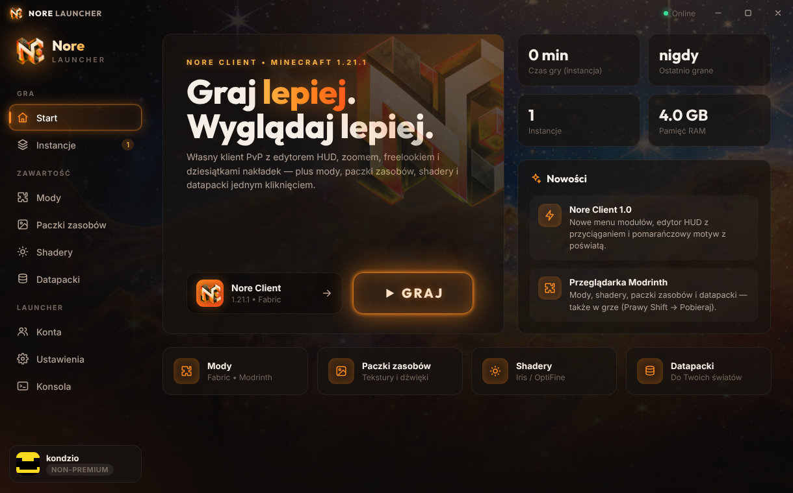

## Nore Launcher

| Mody z Modrinth | Instancje |
|---|---|
| 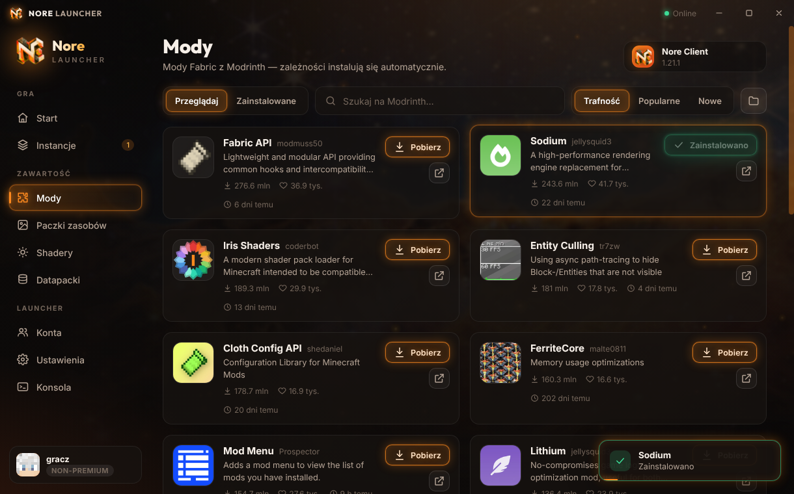 | 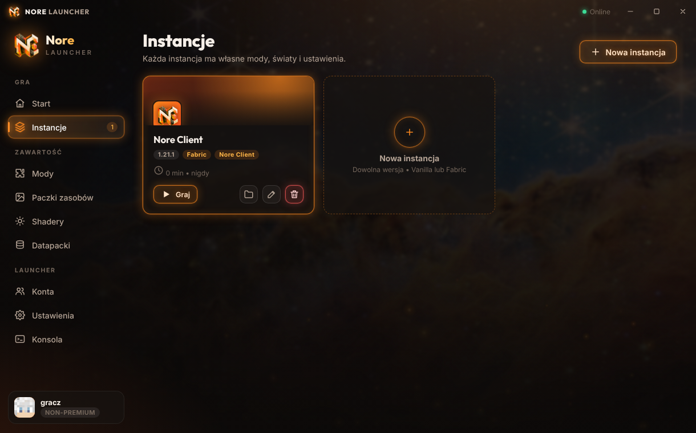 |
| **Konta premium i non-premium** | **Ustawienia** |
| 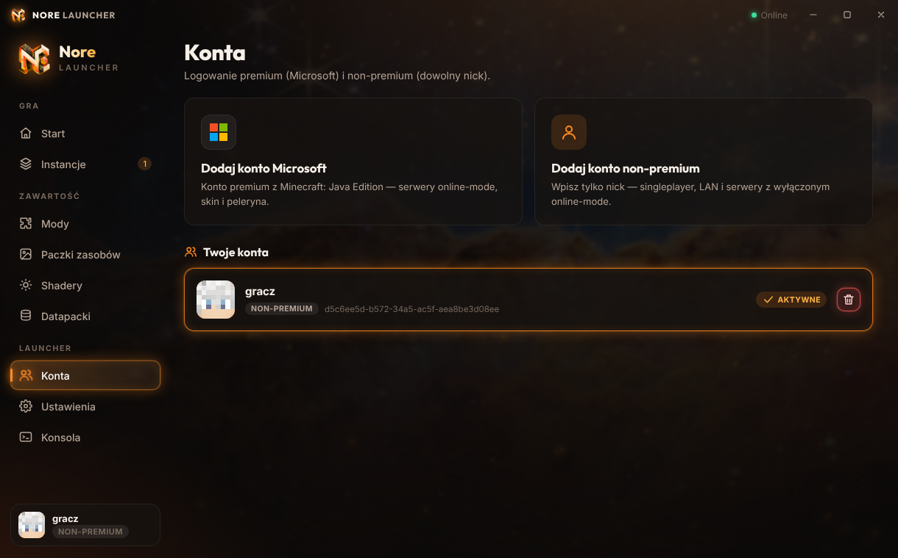 | 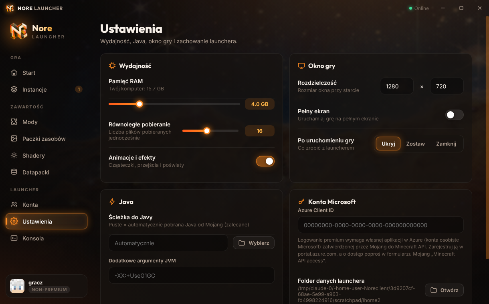 |
| **Kreator pierwszego uruchomienia** | **Animowana instalacja gry** |
| 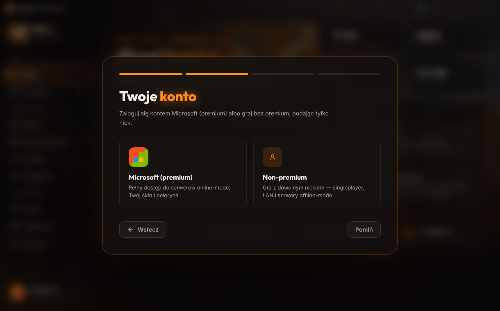 | 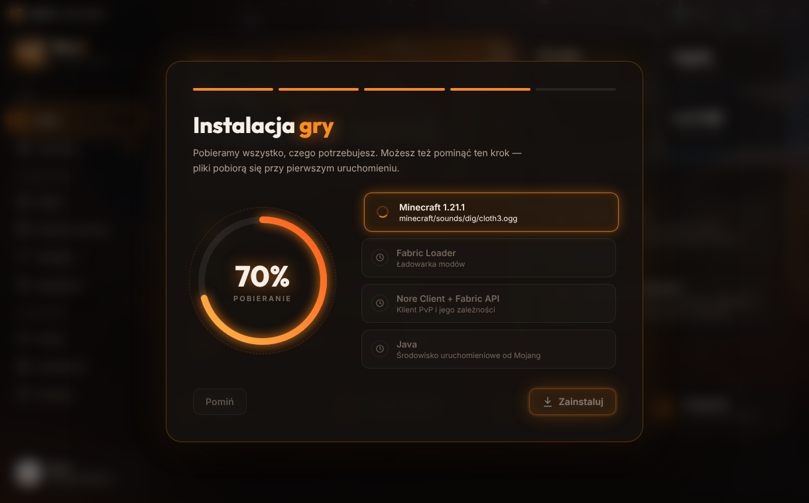 |

**Możliwości**
- **Wszystkie wersje Minecraft** (wydania i snapshoty) – pliki pobierane prosto z serwerów Mojang z weryfikacją SHA-1,
  wiele plików naraz (regulowane), praca offline po pobraniu.
- **Fabric** dla dowolnej wspieranej wersji, **Nore Client + Fabric API** instalowane automatycznie dla 1.21.1.
- **Java dobierana automatycznie** (oficjalne środowiska Mojang) albo własna ścieżka.
- **Instancje** – osobne foldery z modami, światami i ustawieniami; kolor, RAM per instancja, auto-dołączanie do serwera, czas gry.
- **Przeglądarka Modrinth**: mody (z zależnościami), paczki zasobów, shadery i datapacki (instalowane do wybranego świata);
  zakładka „Zainstalowane” z włączaniem/wyłączaniem i usuwaniem.
- **Konta**: Microsoft/premium (logowanie kodem urządzenia, odświeżanie sesji, tokeny szyfrowane systemowo)
  oraz non-premium (dowolny nick).
- **Konsola** z logami gry na żywo, zatrzymywanie gry, ukrywanie launchera po starcie.
- **Wygląd**: animowane tło (zdjęcie JWST z efektem Ken Burns i paralaksą), unoszące się iskry, przyciski z poświatą,
  płynne przejścia stron, kaskadowe animacje kart, przesuwany wskaźnik w menu, ekran startowy, powiadomienia.

### Instalator wersji – Vanilla albo z modami, każda wersja

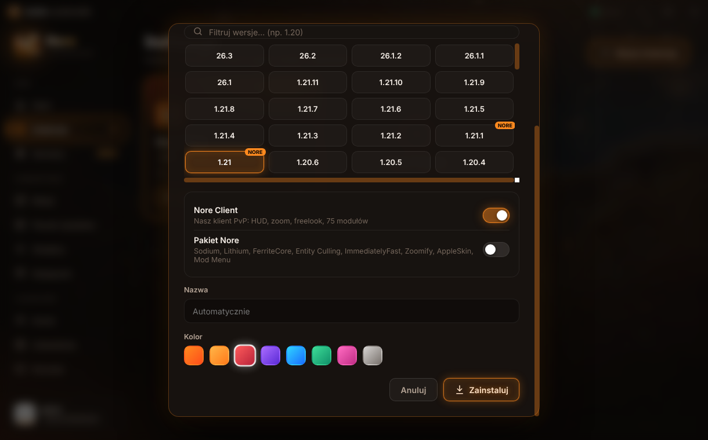

Przy pobieraniu wybierasz **wersję** (wszystkie wydania i snapshoty) i **rodzaj**:
- **Vanilla** – czysta gra, działa dla każdej wersji (także bardzo starych, np. 1.8.9 z Javą 8).
- **Z modami** – Fabric oraz:
  - **Nore Client** (wersje **1.21 i 1.21.1**, oznaczone NORE),
  - **Pakiet Nore** dla *każdej* wersji wspieranej przez Fabric (1.14+): Sodium, Lithium, FerriteCore,
    Entity Culling, ImmediatelyFast, Zoomify, AppleSkin, Mod Menu + Fabric API – dobierane automatycznie
    pod wybraną wersję (przetestowane np. na 1.20.4).

### Edycja pobranych wersji (instancji)

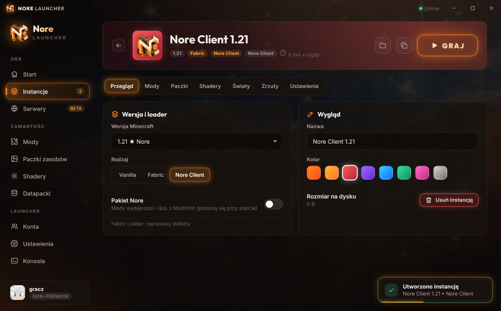

Kliknij instancję, aby wejść w jej szczegóły: **zmiana wersji Minecraft**, przełączanie Vanilla / Fabric /
Nore Client, Pakiet Nore, nazwa i kolor, duplikowanie, rozmiar na dysku, a w zakładkach: **mody, paczki
zasobów i shadery** (włączanie/wyłączanie/usuwanie), **światy** (kopia zapasowa .zip, datapacki, usuwanie),
**zrzuty ekranu** (podgląd i usuwanie) oraz **ustawienia** (RAM, argumenty JVM, rozdzielczość, auto-dołączanie).
W *Ustawieniach* launchera jest lista pobranych wersji gry z rozmiarem i usuwaniem.

### Serwery (BETA)

| Lista serwerów | Konsola i ustawienia |
|---|---|
| 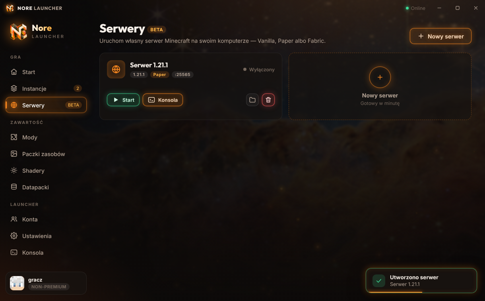 | 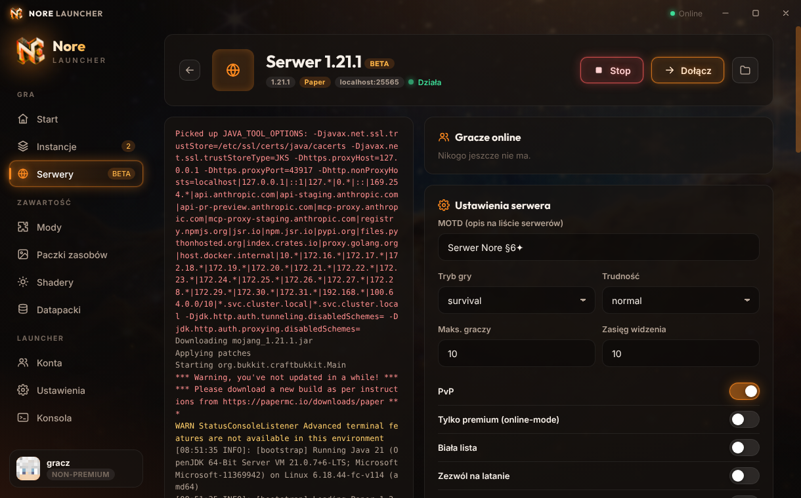 |

Własny serwer na Twoim komputerze: **Vanilla, Paper lub Fabric**, dowolna wersja. Start/stop, konsola na żywo
z wpisywaniem komend, lista graczy (OP / wyrzucanie), edycja `server.properties` (MOTD, tryb gry, trudność,
PvP, online-mode, biała lista…), RAM i port, akceptacja EULA, oraz przycisk **Dołącz**, który od razu
uruchamia grę i łączy z serwerem. Java dobierana automatycznie do wersji serwera.

### Instalator `.exe`

| Powitanie | Zakończenie |
|---|---|
| 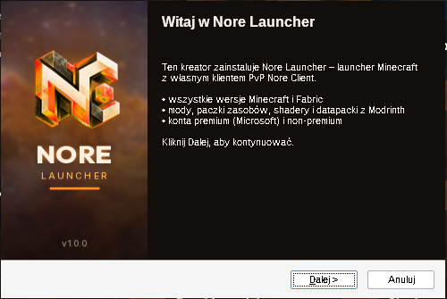 | 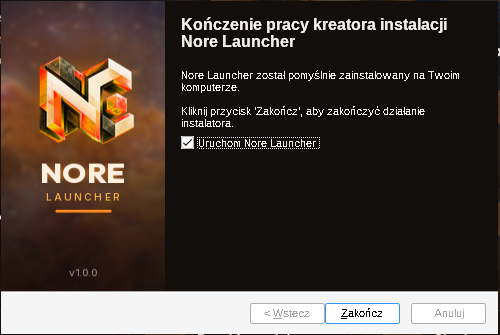 |

Polski instalator z własną grafiką: wybór folderu i użytkownika, licencja, skróty na pulpicie i w menu Start,
uruchomienie po instalacji, deinstalator. Po pierwszym starcie launcher prowadzi przez animowany kreator:
konto → RAM → instalacja gry z pierścieniem postępu.

### Budowanie launchera

```bash
./gradlew build                 # najpierw mod (trafi do instalatora)
cd launcher
npm install
npm start                       # uruchomienie w trybie deweloperskim
npm test                        # testy rdzenia
npm run dist:win                # instalator Windows -> launcher/dist/NoreLauncher-Setup-1.0.0.exe
npm run dist:linux              # AppImage
npm run dist:mac                # DMG (na macOS)
```

Na Linuksie do budowania `.exe` potrzebny jest Wine (`wine64` + `wine32`). Najprościej użyć GitHub Actions —
workflow `.github/workflows/build.yml` buduje mod oraz instalatory Windows/Linux/macOS przy każdym pushu
(pliki w zakładce *Actions → Artifacts*).

### Logowanie Microsoft (premium)

Mojang wymaga, aby każdy launcher miał własną aplikację Azure zatwierdzoną do Minecraft API:
1. Zarejestruj aplikację na [portal.azure.com](https://portal.azure.com) (typ kont: *osobiste konta Microsoft*, włącz *public client flows*).
2. Złóż wniosek o dostęp do Minecraft API (formularz Mojang „Minecraft API access”).
3. Wpisz *Application (client) ID* w launcherze: **Ustawienia → Konta Microsoft**.

Do tego czasu można grać na koncie non-premium (singleplayer, LAN, serwery z `online-mode=false`).

## Nore Client (mod)

| Menu główne | Menu modułów |
|---|---|
| 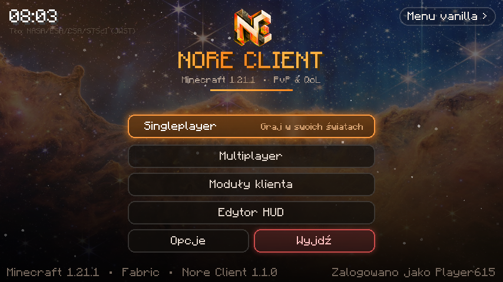 | 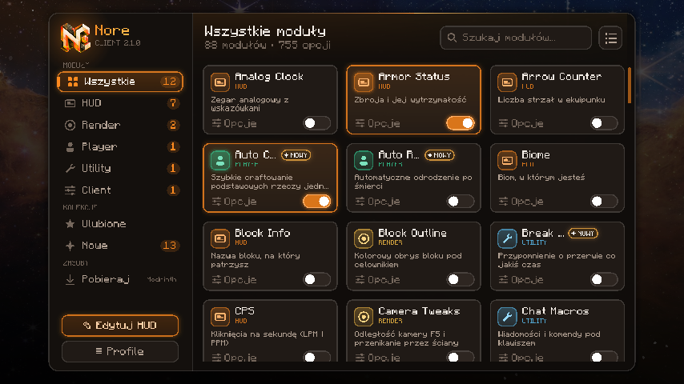 |
| **Pobieraj w grze (Modrinth)** | **Menu pauzy** |
| 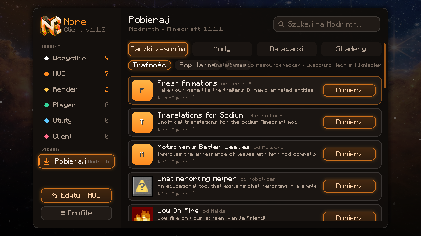 | 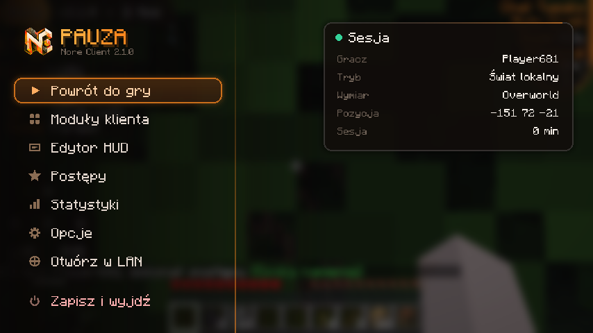 |

### Nowe w 2.1

| Auto Craft | Nowe moduły |
|---|---|
| 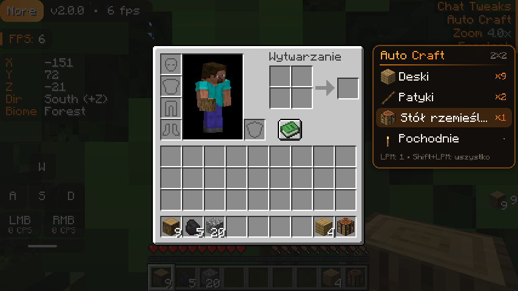 | 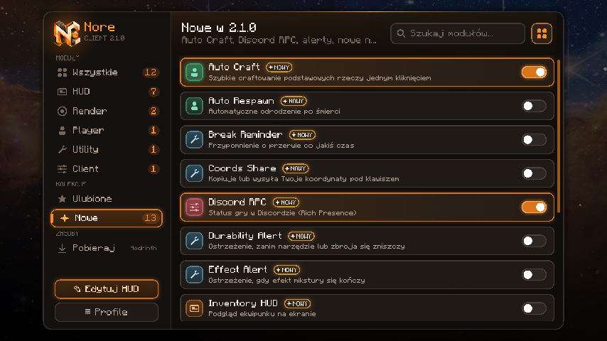 |
| **Ekrany Minecrafta w stylu Nore** | |
| 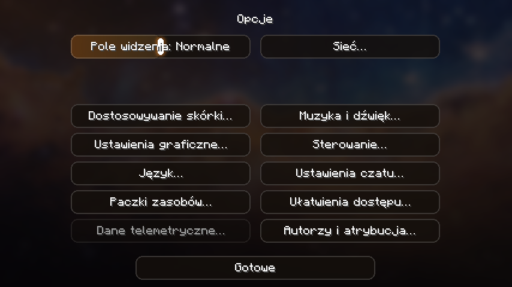 | |

- **Auto Craft** – panel obok ekwipunku i stołu rzemieślniczego: deski, patyki, stół, pochodnie, skrzynia, piec,
  drabina, narzędzia, drzwi, chleb… jednym kliknięciem (Shift+klik = wszystko). Brakujące deski i patyki robi sam.
  Działa przez księgę receptur, a gdy przepis nie jest odblokowany – zwykłymi kliknięciami (każdy serwer).
- **Discord RPC** – status w Discordzie (menu / świat / serwer, wymiar, czas gry, przycisk) z moda i z launchera.
  Wystarczy wpisać *Application ID* w launcherze: **Ustawienia → Discord**.
- **Koniec z vanilla UI** – menu główne i pauzy zawsze Nore, a wszystkie pozostałe ekrany Minecrafta (opcje, światy,
  serwery, tworzenie świata…) mają przyciski, suwaki, pola tekstowe, listy i tło w stylu klienta.
- **Odświeżone menu modułów** – ikony kategorii, karty z kafelkami, **Ulubione** (gwiazdka), kolekcja **Nowe**,
  widok siatki / listy, gotowe motywy kolorów (Nore Orange, Crimson, Violet, Ocean, Emerald, Sakura, Gold, Ice).
- **Nowe moduły**: Inventory HUD, Stopwatch, Last Death, TPS, Item Counter (dowolny przedmiot), Durability Alert,
  Low Health Alert (winieta), Effect Alert, Break Reminder, Coords Share, Auto Respawn.

- **Styl**: pomarańczowy motyw, wszystkie przyciski z poświatą („glow outline”), logo w menu, animacje wejścia,
  własne menu główne i menu pauzy (Powrót do gry, Moduły, Edytor HUD, Postępy, Statystyki, Ustawienia, LAN, Wyjdź).
- **Pobieraj w grze** (`Prawy Shift` → *Pobieraj*): paczki zasobów (włączane jednym kliknięciem), mody, datapacki
  do aktualnego świata i shadery prosto z Modrinth, z ikonami i sortowaniem.
- **Menu modułów**: kategorie, wyszukiwarka, przełączniki, suwaki, wybór trybów, color picker z trybem tęczy, przypisywanie klawiszy, profile.
- **Edytor HUD** (`H`): przeciąganie, przyciąganie do linii pomocniczych, skalowanie, panel elementów.
- **88 modułów i 755 opcji** (licznik widać w menu modułów). Nakładki HUD (53): FPS, CPS, Keystrokes, Coordinates,
  Armor Status, Potion Effects, Target HUD, Compass, Combo, Reach, **wykres FPS, zegar analogowy, wskaźnik
  odnowienia ataku / naciągnięcia łuku**, licznik dni, poziom światła, liczba bytów, nasycenie, HP, XP, liczniki
  strzał / totemów / pereł / złotych jabłek, czas sesji, data, pogoda, czas w grze, obrót, prędkość pionowa,
  przebyty dystans, licznik śmierci i uderzeń, informacja o bloku, chunk, wymiar, gracze online, czas klatki,
  silnik serwera, stan ruchu, odległość do celu, paczki zasobów, informacje o systemie, biom, elytra, czas do nocy.
  Każda nakładka tekstowa ma własny styl, nawiasy, tło, kolory, cień i skalę.
- Render: Zoom (`C`), Freelook (`Lewy Alt`), celownik, Fullbright (`B`), **Particles** (ilość i rodzaje cząsteczek,
  mnożnik krytyków), **Fog Control** (mgła świata / woda / lawa / śnieg), **Hand Customizer** (pozycja, skala,
  machnięcie, bez animacji zmiany przedmiotu), **Camera Tweaks** (odległość F5, przenikanie przez bloki),
  **FOV Changer** (do 140°, stałe FOV), **Block Outline** (kolorowy obrys), **Self Nametag**, Time Changer,
  Low Fire, No Hurt Cam, Clear Weather.
- Utility: **Chat Macros** (5 makr pod klawisze), **Chat Tweaks** (historia do 5000 wiadomości, zachowanie czatu
  między serwerami), **Tab Ping** (ping w liczbach), Chat Timestamps, Hide Scoreboard, Toggle Sprint.
- Nore Client działa na Minecraft **1.21 i 1.21.1**; dla pozostałych wersji launcher oferuje Pakiet Nore.

Wszystkie funkcje działają tylko po stronie klienta – bez cheatów.

## Struktura

```
common/                         – rdzeń moda niezależny od wersji MC (Java 8: moduły, GUI, HUD, konfiguracja)
platforms/<wersja>/             – implementacja dla danej wersji Minecrafta (Game/Gfx, mixiny); ./gradlew build buduje wszystkie
dist/mods/                      – zbudowane mody (noreclient-<platforma>.jar), które launcher dołącza do instalatora
launcher/src/main/              – proces główny launchera (pobieranie, Java, konta, uruchamianie, Modrinth)
launcher/src/renderer/          – interfejs launchera (HTML/CSS/JS)
launcher/build/                 – grafiki i konfiguracja instalatora NSIS
branding/                       – logo (pomarańczowe + oryginalne niebieskie), ikona .ico
```

## Licencje

Kod: Apache-2.0. Tło: „Cosmic Cliffs”, NASA/ESA/CSA/STScI (domena publiczna). Czcionki Inter i Outfit: SIL OFL 1.1.
Minecraft jest znakiem towarowym Mojang; projekt nie jest z nim powiązany. Do gry potrzebna jest licencja Minecraft: Java Edition.
